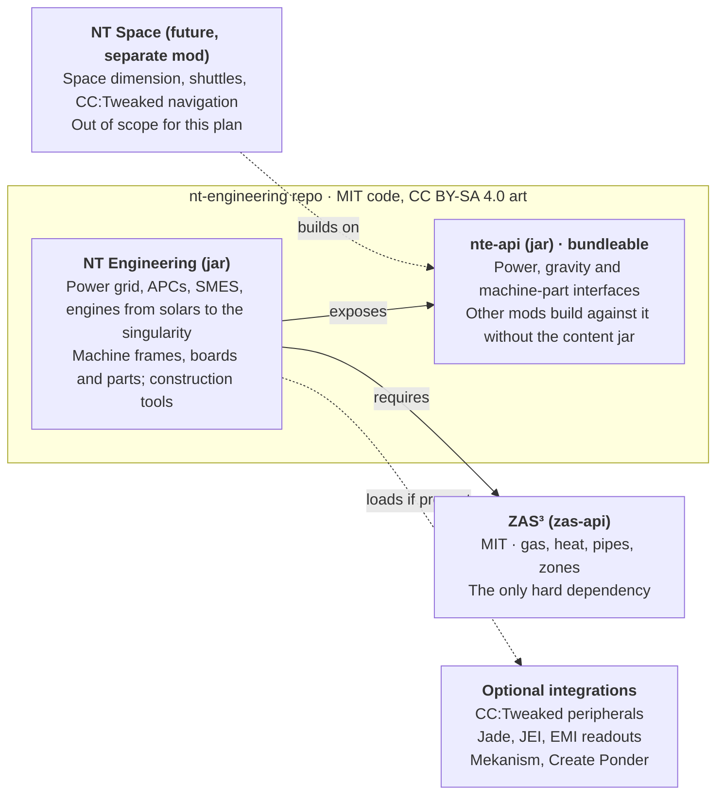
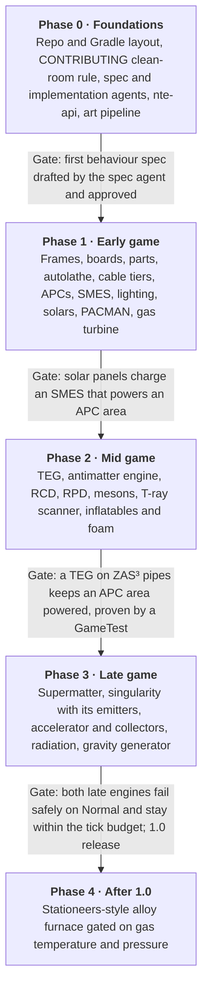

# NT Engineering — Design Proposal

As of 2026-11-13. Living version: [Claude doc](https://claude.ai/artifact/P13djCnpusXSAFMy9KWTBs).

## Summary

NT Engineering recreates vgstation13's Engineering department for Minecraft as an MIT, clean-room companion to ZAS³. It ships one content mod plus a small API jar. Space travel is out of scope; it becomes a separate mod later.

- **License:** MIT for code, written from scratch with vgstation13 as a design reference only, the same rule ZAS³ follows. Sprites are ported from vg under CC BY-SA, with attribution.
- **Packaging:** one `nt_engineering` jar plus a bundleable `nte-api` jar, in a new repo of its own. Per-engine config toggles replace per-engine mods.
- **Engine ladder:** early game is solars and combustion (PACMAN, gas turbine); mid game is the TEG and the antimatter engine; late game is supermatter and the singularity. They feed an SS13 power grid whose APCs take over atmos power from ZAS³'s area air controllers.
- **Machines are built SS13-style:** place a machine or computer frame, insert a circuit board, then add tiered parts. Better parts upgrade a machine where it stands. APCs, atmos components and wall-mounted devices print whole from the autolathe instead.
- **Autolathe economy:** everything it prints also has a crafting recipe. A print costs the recipe's raw materials and yields 2, 4, 8 or 16 items across its four part tiers.
- **Left to other mods:** fission, fusion and shield generators, which NuclearCraft and similar mods do better. Automation is CC:Tweaked's job.
- **Stationeers layer:** three cable tiers with capacity ceilings (burnout on Hardcore only) and an alloy furnace gated on gas temperature and pressure.
- **First milestone:** solar panels charging an SMES that powers an APC area.

## Licensing and clean-room rules

Code is MIT and written from scratch; art is CC BY-SA 4.0 and may be ported from vg's sprites. This mirrors [ZAS³](https://github.com/west3436/zas-cubed), so code can move freely between the two mods.

**Code: what clean-room means in practice.** vgstation13's code is GPLv3 and AGPLv3 ([README](https://github.com/vgstation-coders/vgstation13)); translating it to Java would make a derivative work. So:

1. **Read vg for behaviour, not for code.** Play it, read the wiki and skim the source to learn what a device does, what it needs and how it fails.
2. **Write a behaviour spec per feature in your own words.** It covers inputs, outputs, states, failure modes and what the player sees. No DM code, no pseudo-code that mirrors DM structure, no lifted variable names.
3. **Implement from the spec, not from the DM file.** Separate agents do the two jobs, with you in between: a spec agent reads vg and drafts the spec, you review and approve it, and an implementation agent that has never seen vg's code writes the Java from the approved spec alone.
4. **Tune numbers for Minecraft yourself.** vg balances on machine ticks of about 2 seconds and single tiles; Minecraft runs 20 ticks a second on blocks, so constants need re-deriving anyway.
5. **Don't import map layouts.** vg's `.dmm` maps fall under the code license, so prebuilt engine rooms and structures are designed fresh.
6. **Put the rule in CONTRIBUTING.md**, worded like ZAS³'s, so outside contributors follow it too.

**Art: port with attribution.** vg's assets are CC BY-SA 3.0 unless marked otherwise. BY-SA 3.0 lets adaptations use a later version, so ported sprites can ship under CC BY-SA 4.0 like ZAS³'s. Keep a CREDITS entry per source file, and match ZAS³'s style of vg colours with a vanilla finish.

**Exclusions:**

- Anything under vg's `goon/` folder: it is [CC BY-NC-SA 3.0](https://raw.githubusercontent.com/vgstation-coders/vgstation13/Bleeding-Edge/goon/LICENSE.md), and NonCommercial terms conflict with MIT and with paid platforms.
- Any sprite marked with a different license, or whose origin you can't trace. Check before porting, not after.
- Text from vg's wiki, for Ponder scenes or guides: write your own.

This is not legal advice.

## Packaging: one content mod and an API jar

Ship one `nt_engineering` jar and a small `nte-api` jar from a new repo of its own, the way ZAS³ ships `zas` and `zas-api`. Splitting engines into separate mods would add version juggling for little gain: they share the grid, machine frames and radiation. Per-engine config toggles give packs the same control.

Every jar targets NeoForge 1.21.1, like ZAS³. Arrows point from a module to what it depends on; dashed means optional.

- **ZAS³ is the only hard dependency.** Integrations live in `compat-*` source folders inside the main jar and load only when their mod is present, as in ZAS³.
- **`nte-api` can be bundled** by other mods, so they can add generators, consumers or machine parts and still run when NT Engineering isn't installed.
- **The space mod comes later as its own mod**, built on `nte-api` and NT Engineering.

## Power and engines

The engine ladder follows the game: solars and combustion early, the TEG and antimatter mid game, supermatter and the singularity late. Each step is harder to run and worse when it fails. ZAS³ already ships atmos devices, airlocks, suits, basic tools and cable-less FE power, so none of that is repeated. The "vg reference" column says where to read behaviour, under `code/modules/` in [vgstation13](https://github.com/vgstation-coders/vgstation13).

| Element | vg reference | Minecraft form | Ties to ZAS³ | Stage | Phase |
| --- | --- | --- | --- | --- | --- |
| Power grid | `power/cable.dm`, `cable_heavyduty.dm`, `powernet.dm`, `terminal.dm`, `monitor.dm` | Three cable tiers under floors, each with a capacity ceiling; power monitor computer. On Normal a cable caps its output at its ceiling; on Hardcore an overload burns it and can start a fire. | FE adapter at the grid edge | All | 1 |
| APCs and areas | `power/apc.dm`, station blueprints | One APC per area with equipment, lighting and environment channels; breakers, cell backup, hackable wires. Printed whole from the autolathe. Blueprints mark areas. | When installed, APCs replace area air controllers as the power source for every atmos device in their area; AACs keep monitoring and control | All | 1 |
| Storage | `power/smes.dm`, `cell.dm`, `battery.dm`, `battery_port.dm` | SMES with input and output terminals, power cells, battery banks. | — | All | 1 |
| Lighting | `power/lighting/` | Tube and bulb fixtures on the lighting channel; they flicker on brownouts. | — | All | 1 |
| Solars | `power/solar.dm`, `power/solars/` | Panels, trackers and a solar control computer that follow the sun. | — | Early | 1 |
| PACMAN | `power/port_gen.dm` | Portable combustion generators burning plasma or uranium sheets. | Exhaust and heat into the zone | Early | 1 |
| Gas turbine | `power/turbine.dm` | Compressor, combustion chamber and turbine. | Burns zone gas with ZAS³ fire | Early | 1 |
| Thermoelectric generator | `power/generator.dm` | TEG with two circulators; power from the difference between a hot and a cold gas loop. | Both loops are ZAS³ pipe networks | Mid | 2 |
| Antimatter engine | `power/antimatter/` | Control unit, shielding blocks, fuel jars. | — | Mid | 2 |
| Supermatter | `supermatter/supermatter.dm` | Crystal energised by emitters and cooled by a gas loop; delamination when it overheats. | Reads and changes zone gas and heat | Late | 3 |
| Singularity engine | `power/singularity/` | Particle accelerator, field generators, containment field, emitter beams, radiation collectors fed plasma tanks. A loose singularity eats blocks on Hardcore only. | Collectors draw tank plasma | Late | 3 |
| Radiation | collectors and engine code | Geiger counter, radiation suits, radiation from engines. | Through ZAS³ hazards if they can express it | Late | 3 |
| Gravity generator | `power/gravitygenerator.dm` | A large power sink that a future space mod can use for artificial gravity. | — | Late | 3 |

Fission, fusion (vg's R-UST) and shield generators are left out: NuclearCraft and similar mods already do them better.

The treadmill (`power/treadmill.dm`, player-powered generation) is a cheap, very SS13 extra for Phase 1.

## Machine construction and tools

Every NT machine and computer is built SS13-style, so construction is the progression: a better engine is something you assemble and upgrade in place, not a multiblock you craft once. The Stationeers rows are original designs, not vg ports.

**Building a machine:**

1. Place a machine frame (or a computer frame) from metal sheets.
2. Wire it with cable.
3. Insert the circuit board for the machine you want.
4. Add the parts the board lists, then close it with a screwdriver.
5. To upgrade later, open the panel and swap in higher-tier parts. Output or efficiency rises with the parts' tier.

| Element | Source of the idea | Minecraft form | Phase |
| --- | --- | --- | --- |
| Machine and computer frames | vg machine and computer construction | The build steps above. Computers take a board, wiring and a glass screen. Used by every NT machine and console. | 1 |
| Stock parts | vg stock parts | Capacitors, manipulators, matter bins, micro-lasers and scanning modules in tiers; higher tiers need better materials. | 1 |
| Circuit printer | vg circuit imprinter, without R&D | Prints circuit boards from metal, glass and gold. | 1 |
| Autolathe | vg autolathe | Prints tools, frames, parts, APCs, atmos components and wall-mounted devices; see the autolathe economy below. | 1 |
| Electrical tools | vg cable coil, wirecutters, insulated gloves | Laying and cutting cable; live cables and APCs shock bare hands. ZAS³'s multitool and wrench are reused, not duplicated. | 1 |
| Welding | vg welding tool and welding mask | Fuel-burning welder for wall deconstruction and repairs; eye damage without a mask. | 1 |
| RCD and RPD | vg `RCD/` | Rapid construction device for walls and floors; rapid pipe dispenser that places ZAS³ pipes. | 2 |
| Engineering vision | vg meson goggles and T-ray scanner | Mesons show structure through walls; the T-ray scanner shows pipes and cables under floors, ZAS³'s included. | 2 |
| Breach repair | vg inflatables and metal foam | Inflatable walls and doors, foam that hardens into a wall; all airtight for ZAS³. | 2 |
| Alloy furnace | Stationeers | Alloys such as plasteel and plasma glass need a gas mix inside a temperature and pressure window, read from ZAS³. Built from a frame like any other machine. | 4 |

**Autolathe economy:**

- Every item the autolathe prints also has a crafting recipe. The autolathe is the efficient path, never the only one.
- A print costs the raw materials of the item's crafting recipe, resolved down to base materials such as metal and glass.
- Four tiers, set by the autolathe's parts. One craft's worth of materials yields 2 items at tier 1, 4 at tier 2, 8 at tier 3 and 16 at tier 4.
- Printed whole: APCs, atmospherics components, and anything mounted on a wall rather than filling a block, such as area air controllers. Everything else prints as a frame, a board and parts, assembled in place.

Out of scope: logic networks (CC:Tweaked covers automation), R&D, telecomms, mining, and everything to do with space and shuttles.

## What ZAS³ needs to provide

With space out of scope, ZAS³ 1.0.0 already covers almost everything; the open items are the APC hand-off, radiation and shared areas. Target NeoForge 1.21.1 to match, and build against `zas-api` only, as ZAS³'s own content module does.

| Need | Status in ZAS³ | Used by |
| --- | --- | --- |
| Gas-handler capability on pipes and devices | Shipped ([#296](https://github.com/west3436/zas-cubed/pull/296)) | TEG loops, collectors, turbine |
| Heat mutations | Shipped ([#175](https://github.com/west3436/zas-cubed/pull/175)) | Supermatter, PACMAN, TEG |
| Zone gas reads and mutations | In the API | Supermatter, turbine, alloy furnace |
| Airtight custom blocks | Seals come from block shape | Inflatables, foam |
| A hook that lets APCs take over power supply from area air controllers, leaving AACs in charge of monitoring and control | To request: today devices take FE distributed through controllers | APCs |
| Radiation as a hazard type | Unclear: hazards are datapack-driven | Engines, Geiger counter |
| Area definitions shared between mods | Unclear: AACs already cover areas | APCs, lighting, power channels |

Both mods are MIT and clean-room, so shared helpers can move into `zas-api` as code, not just as feature requests.

## Also worth doing

Match ZAS³'s quality bar from the first release; most of these are cheap if started early.

1. **Ponder scenes and GameTests.** A scene for every machine and tests for every engine's failure path, as ZAS³ has.
2. **Normal and Hardcore presets.** Hardcore turns on cable burnout, block-eating singularities and supermatter delamination damage; Normal keeps them contained.
3. **Admin and profiling commands.** A `/nte` tree mirroring ZAS³'s `/zas`: inspect a powernet, force an engine state, profile tick cost.
4. **Compatibility.** CC:Tweaked peripherals for the grid and every engine; Jade, JEI and EMI readouts; Mekanism heat and energy; Create's Ponder.
5. **Hooks for a future space mod.** Keep gravity and power draw behind `nte-api`, so the space mod can use them without depending on internals.

## Roadmap

Each phase delivers one game stage: early power first, then the TEG and antimatter, then supermatter and the singularity for 1.0. Stationeers alloys follow after 1.0. Phase numbers match the tables above.

The Phase 2 gate proves the whole idea: ZAS³ gas driving an SS13 engine that powers an SS13 room.

## Decisions

| Topic | Decision |
| --- | --- |
| Engine tiers | Early: solars and combustion (PACMAN, gas turbine). Mid: TEG and antimatter. Late: supermatter and singularity. |
| Atmos power | When NT Engineering is installed, APCs replace area air controllers as the power source for every atmos device in their area. AACs still monitor and control those devices. |
| Cable limits | Three cable tiers. On Normal a cable caps its output at its ceiling; burnout only on Hardcore. |
| Machines | Built SS13-style from frames, boards and tiered parts instead of multiblocks; parts are the upgrade path. |
| Autolathe | Everything it prints also has a crafting recipe. Print cost is the recipe's raw materials. Four tiers yield 2, 4, 8 and 16 items per craft's worth. APCs, atmos components and wall-mounted devices print whole. |
| Repository | A new repo, separate from ZAS³. |
| Clean-room workflow | Separate spec and implementation agents, with you approving each spec in between. |
| Scope cuts | Fission, fusion and shield generators go to dedicated mods such as NuclearCraft; logic networks are covered by CC:Tweaked. |

## Sources

- [ZAS³ repository and README](https://github.com/west3436/zas-cubed) and [release 1.0.0](https://github.com/west3436/zas-cubed/releases/tag/v1.0.0)
- [vgstation13 repository and license](https://github.com/vgstation-coders/vgstation13); [goon/ license](https://raw.githubusercontent.com/vgstation-coders/vgstation13/Bleeding-Edge/goon/LICENSE.md)
- vg module listings: [power/](https://api.github.com/repos/vgstation-coders/vgstation13/contents/code/modules/power?ref=Bleeding-Edge), [singularity/](https://api.github.com/repos/vgstation-coders/vgstation13/contents/code/modules/power/singularity?ref=Bleeding-Edge)
- [CC:Tweaked REUSE.toml](https://raw.githubusercontent.com/cc-tweaked/CC-Tweaked/mc-1.21.x/REUSE.toml)
