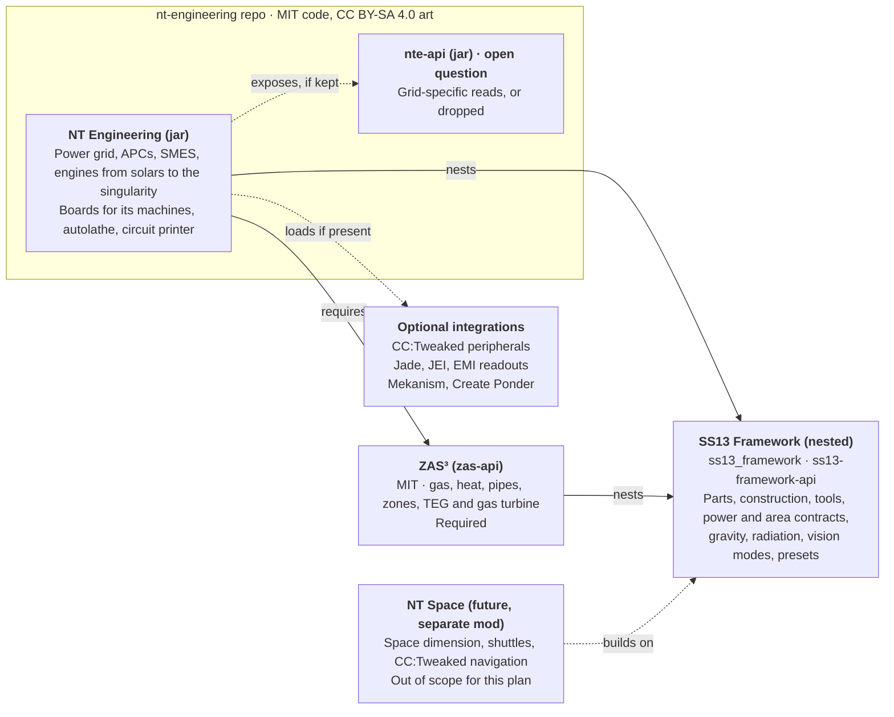
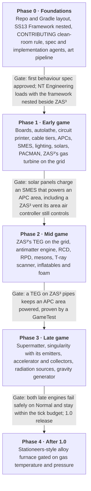

# NT Engineering — Design Proposal

As of 2026-11-23. Living version: [Claude doc](https://claude.ai/artifact/P13djCnpusXSAFMy9KWTBs); it predates the move to SS13 Framework.

Links written as fw#N point to issues in [ss13-framework](https://github.com/west3436/ss13-framework).

## Summary

NT Engineering recreates vgstation13's Engineering department for Minecraft as an MIT, clean-room companion to ZAS³. It ships one content mod that nests [SS13 Framework](https://github.com/west3436/ss13-framework) and requires ZAS³. Space travel is out of scope; it becomes a separate mod later.

- **License:** MIT for code, written from scratch with vgstation13 as a design reference only, the same rule ZAS³ follows. Sprites are ported from vg under CC BY-SA, with attribution.
- **Packaging:** one `nt_engineering` jar in a new repo of its own, nesting SS13 Framework and requiring ZAS³. The power, gravity and machine-part interfaces planned for `nte-api` move into `ss13-framework-api`. Per-engine config toggles replace per-engine mods.
- **Shared base:** SS13 Framework supplies stock parts, construction, tools, power and area contracts, gravity, radiation, vision modes and the Normal/Hardcore switch. NT Engineering keeps the grid, APCs, SMES, lighting, the engines, the autolathe and the circuit printer.
- **Engine ladder:** early game is solars and combustion (PACMAN, ZAS³'s gas turbine); mid game is ZAS³'s TEG and the antimatter engine; late game is supermatter and the singularity. They feed an SS13 power grid whose APCs take over atmos power from ZAS³'s area air controllers through the framework's power provider contract.
- **Machines are built SS13-style:** place a machine or computer frame, insert a circuit board, then add tiered parts. Frames, parts and tiers come from the framework; NT Engineering supplies the boards for its machines. Better parts upgrade a machine where it stands. APCs, atmos components and wall-mounted devices print whole from the autolathe instead.
- **Autolathe economy:** everything it prints also has a crafting recipe. A print costs the recipe's raw materials and yields 2, 4, 8 or 16 items across its four part tiers.
- **Left to other mods:** fission, fusion and shield generators, which NuclearCraft and similar mods do better. Automation is CC:Tweaked's job.
- **Stationeers layer:** three cable tiers with capacity ceilings (burnout on Hardcore only) and an alloy furnace gated on gas temperature and pressure.
- **First milestone:** solar panels charging an SMES that powers an APC area.

## Licensing and clean-room rules

Code is MIT and written from scratch; art is CC BY-SA 4.0 and may be ported from vg's sprites. This mirrors [ZAS³](https://github.com/west3436/zas-cubed) and SS13 Framework, so code can move freely between the three.

**Code: what clean-room means in practice.** vgstation13's code is GPLv3 and AGPLv3 ([README](https://github.com/vgstation-coders/vgstation13)); translating it to Java would make a derivative work. So:

1. **Read vg for behaviour, not for code.** Play it, read the wiki and skim the source to learn what a device does, what it needs and how it fails.
2. **Write a behaviour spec per feature in your own words.** It covers inputs, outputs, states, failure modes and what the player sees. No DM code, no pseudo-code that mirrors DM structure, no lifted variable names.
3. **Implement from the spec, not from the DM file.** Separate agents do the two jobs, with you in between: a spec agent reads vg and drafts the spec, you review and approve it, and an implementation agent that has never seen vg's code writes the Java from the approved spec alone.
4. **Tune numbers for Minecraft yourself.** vg balances on machine ticks of about 2 seconds and single tiles; Minecraft runs 20 ticks a second on blocks, so constants need re-deriving anyway.
5. **Don't import map layouts.** vg's `.dmm` maps fall under the code license, so prebuilt engine rooms and structures are designed fresh.
6. **Put the rule in CONTRIBUTING.md**, worded like ZAS³'s, so outside contributors follow it too.

**Art: port with attribution.** vg's assets are CC BY-SA 3.0 unless marked otherwise. BY-SA 3.0 lets adaptations use a later version, so ported sprites can ship under CC BY-SA 4.0 like ZAS³'s. Keep a CREDITS entry per source file, and match ZAS³'s style of vg colours with a vanilla finish.

**Exclusions:**

- Anything under vg's `goon/` folder: it is [CC BY-NC-SA 3.0](https://raw.githubusercontent.com/vgstation-coders/vgstation13/Bleeding-Edge/goon/LICENSE.md), and NonCommercial terms conflict with MIT and with paid platforms.
- Any sprite marked with a different license, or whose origin you can't trace. Check before porting, not after.
- Text from vg's wiki, for Ponder scenes or guides: write your own.

This is not legal advice.

## Packaging: one content mod on SS13 Framework

Ship one `nt_engineering` jar from a new repo of its own. It nests SS13 Framework, as ZAS³ and Expedition do, and requires ZAS³. Splitting engines into separate mods would add version juggling for little gain: they share the grid and its APCs. Per-engine config toggles give packs the same control.

Every jar targets NeoForge 1.21.1, like ZAS³. Arrows point from a module to what it depends on; dashed means optional.

- **ZAS³ is the only hard dependency players install.** SS13 Framework is nested jar-in-jar with a version range, and NeoForge loads the newest nested copy ([fw#3](https://github.com/west3436/ss13-framework/issues/3)). Integrations live in `compat-*` source folders inside the main jar and load only when their mod is present, as in ZAS³.
- **`nte-api`'s stated purpose moves to the framework.** The power, gravity and machine-part interfaces it was meant to hold go into `ss13-framework-api`, which other mods can already build against without NT Engineering. The framework proposal recommends that `nte-api` shrink to grid-specific reads or go away; which one is an open question.
- **The space mod comes later as its own mod**, built on the framework API and NT Engineering.

## Power and engines

The engine ladder follows the game: solars and combustion early, the TEG and antimatter mid game, supermatter and the singularity late. Each step is harder to run and worse when it fails. ZAS³ already ships atmos devices, airlocks, suits, the TEG, the gas turbine and cable-less FE power, and SS13 Framework supplies the power, area, gravity and radiation contracts, so none of that is repeated. The "vg reference" column says where to read behaviour, under `code/modules/` in [vgstation13](https://github.com/vgstation-coders/vgstation13).

| Element | vg reference | Minecraft form | Ties to ZAS³ or the framework | Stage | Phase |
| --- | --- | --- | --- | --- | --- |
| Power grid | `power/cable.dm`, `cable_heavyduty.dm`, `powernet.dm`, `terminal.dm`, `monitor.dm` | Three cable tiers under floors, each with a capacity ceiling; power monitor computer. On Normal a cable caps its output at its ceiling; on Hardcore an overload burns it and can start a fire. | FE adapter at the grid edge | All | 1 |
| APCs and areas | `power/apc.dm`, station blueprints | One APC per area with equipment, lighting and environment channels; breakers, cell backup, hackable wires. Printed whole from the autolathe. Blueprints mark areas. | APC takeover is the framework's power provider contract ([fw#10](https://github.com/west3436/ss13-framework/issues/10)): when installed, APCs replace area air controllers as the power source for every atmos device in their area, and AACs keep monitoring and control. Areas come from the framework ([fw#11](https://github.com/west3436/ss13-framework/issues/11)). | All | 1 |
| Storage | `power/smes.dm`, `cell.dm`, `battery.dm`, `battery_port.dm` | SMES with input and output terminals, battery banks. Power cells are the framework's one battery item set, shared with ZAS³'s battery tiers ([fw#10](https://github.com/west3436/ss13-framework/issues/10)). | Framework batteries | All | 1 |
| Lighting | `power/lighting/` | Tube and bulb fixtures on the lighting channel; they flicker on brownouts. | Framework lighting channel | All | 1 |
| Solars | `power/solar.dm`, `power/solars/` | Panels, trackers and a solar control computer that follow the sun. | — | Early | 1 |
| PACMAN | `power/port_gen.dm` | Portable combustion generators burning plasma or uranium sheets. | Exhaust and heat into the zone | Early | 1 |
| Gas turbine | `power/turbine.dm` | Shipped by ZAS³ with FE output ([zas-cubed#530](https://github.com/west3436/zas-cubed/pull/530), [#531](https://github.com/west3436/zas-cubed/pull/531)). NT Engineering connects it to its grid instead of building its own. | ZAS³ device, burns zone gas with ZAS³ fire | Early | 1 |
| Thermoelectric generator | `power/generator.dm` | Shipped by ZAS³ with FE output ([zas-cubed#530](https://github.com/west3436/zas-cubed/pull/530), [#531](https://github.com/west3436/zas-cubed/pull/531)). NT Engineering connects it to its grid instead of building its own. | ZAS³ device; both loops are ZAS³ pipe networks | Mid | 2 |
| Antimatter engine | `power/antimatter/` | Control unit, shielding blocks, fuel jars. | — | Mid | 2 |
| Supermatter | `supermatter/supermatter.dm` | Crystal energised by emitters and cooled by a gas loop; delamination when it overheats. | Reads and changes zone gas and heat | Late | 3 |
| Singularity engine | `power/singularity/` | Particle accelerator, field generators, containment field, emitter beams, radiation collectors fed plasma tanks. A loose singularity eats blocks on Hardcore only. | Collectors draw tank plasma | Late | 3 |
| Radiation | collectors and engine code | Engines are radiation sources. Dose, armour protection, the Geiger counter and suit encumbrance come from the framework. | Framework radiation ([fw#16](https://github.com/west3436/ss13-framework/issues/16)); ZAS³ suits get protection values | Late | 3 |
| Gravity generator | `power/gravitygenerator.dm` | A large power sink that registers a positional gravity provider, so a future space mod gets artificial gravity from it. | Framework gravity at a position ([fw#8](https://github.com/west3436/ss13-framework/issues/8)) | Late | 3 |

Fission, fusion (vg's R-UST) and shield generators are left out: NuclearCraft and similar mods already do them better.

The treadmill (`power/treadmill.dm`, player-powered generation) is a cheap, very SS13 extra for Phase 1.

## Machine construction and tools

Every NT machine and computer is built SS13-style, so construction is the progression: a better engine is something you assemble and upgrade in place, not a multiblock you craft once. Frames, boards, stock parts and tiers come from SS13 Framework ([fw#4](https://github.com/west3436/ss13-framework/issues/4), [fw#12](https://github.com/west3436/ss13-framework/issues/12)), so ZAS³ and Expedition machines use the same parts. NT Engineering supplies the boards for its own machines, the autolathe and the circuit printer. The Stationeers rows are original designs, not vg ports.

**Building a machine:**

1. Place a machine frame (or a computer frame) from metal sheets.
2. Wire it with cable.
3. Insert the circuit board for the machine you want.
4. Add the parts the board lists, then close it with a screwdriver.
5. To upgrade later, open the panel and swap in higher-tier parts. Output or efficiency rises with the parts' tier.

| Element | Source of the idea | Minecraft form | Phase |
| --- | --- | --- | --- |
| Machine and computer frames | vg machine and computer construction | From the framework ([fw#12](https://github.com/west3436/ss13-framework/issues/12)). The build steps above. Computers take a board, wiring and a glass screen. Used by every NT machine and console; NT Engineering registers a board for each. | 1 |
| Stock parts | vg stock parts | From the framework ([fw#4](https://github.com/west3436/ss13-framework/issues/4), [fw#12](https://github.com/west3436/ss13-framework/issues/12)): capacitors, manipulators, matter bins, micro-lasers and scanning modules in four tiers; higher tiers need better materials. | 1 |
| Circuit printer | vg circuit imprinter, without R&D | Prints circuit boards from metal, glass and gold. | 1 |
| Autolathe | vg autolathe | Prints tools, frames, parts, APCs, atmos components and wall-mounted devices; see the autolathe economy below. | 1 |
| Electrical tools | vg cable coil, wirecutters, insulated gloves | Wirecutters, screwdriver, multitool and wrench are framework tools ([fw#13](https://github.com/west3436/ss13-framework/issues/13)); ZAS³'s multitool and wrench move there. NT Engineering registers laying cable from the coil and adds insulated gloves; live cables and APCs shock bare hands. | 1 |
| Welding | vg welding tool and welding mask | The framework's welder ([fw#13](https://github.com/west3436/ss13-framework/issues/13)): burns fuel, eye damage without a mask. NT Engineering uses it for wall deconstruction and repairs. | 1 |
| RCD and RPD | vg `RCD/` | Rapid construction device for walls and floors; rapid pipe dispenser that places ZAS³ pipes. Both use the framework's `ClaimCheck` and `TickBudget` ([fw#9](https://github.com/west3436/ss13-framework/issues/9)). | 2 |
| Engineering vision | vg meson goggles and T-ray scanner | Built on the framework's vision modes ([fw#17](https://github.com/west3436/ss13-framework/issues/17)). Mesons show structure through walls; the T-ray scanner shows what is under floors. NT Engineering registers its cables, ZAS³ its pipes. | 2 |
| Breach repair | vg inflatables and metal foam | Inflatable walls and doors, foam that hardens into a wall; all airtight for ZAS³. | 2 |
| Alloy furnace | Stationeers | Alloys such as plasteel and plasma glass need a gas mix inside a temperature and pressure window, read from ZAS³. Built from a frame like any other machine. | 4 |

**Cable.** ZAS³ removed its power cable on purpose (D-68) and keeps `cable_coil` only as a crafting ingredient. That item moves to the framework with the other components ([fw#4](https://github.com/west3436/ss13-framework/issues/4)). NT Engineering registers placing cable from it rather than adding a second coil.

**Autolathe economy:**

- Every item the autolathe prints also has a crafting recipe. The autolathe is the efficient path, never the only one.
- A print costs the raw materials of the item's crafting recipe, resolved down to base materials such as metal and glass.
- Four tiers, set by the autolathe's parts. One craft's worth of materials yields 2 items at tier 1, 4 at tier 2, 8 at tier 3 and 16 at tier 4.
- Printed whole: APCs, atmospherics components, and anything mounted on a wall rather than filling a block, such as area air controllers. Everything else prints as a frame, a board and parts, assembled in place.

Out of scope: logic networks (CC:Tweaked covers automation), R&D, telecomms, mining, and everything to do with space and shuttles.

## What ZAS³ and SS13 Framework provide

ZAS³ keeps gas: zones, pipes, heat, breathing, and its own TEG and gas turbine. Everything else NT Engineering needs from outside is SS13 Framework work, since none of it is about gas and `zas-api` stays gas-only. Target NeoForge 1.21.1 to match, and build against `zas-api` and `ss13-framework-api`, as ZAS³'s own content module will.

**From ZAS³:**

| Need | Status in ZAS³ | Used by |
| --- | --- | --- |
| Gas-handler capability on pipes and devices | Shipped ([#296](https://github.com/west3436/zas-cubed/pull/296)) | TEG loops, collectors, turbine |
| Heat mutations | Shipped ([#175](https://github.com/west3436/zas-cubed/pull/175)) | Supermatter, PACMAN, TEG |
| Zone gas reads and mutations | In the API | Supermatter, turbine, alloy furnace |
| Airtight custom blocks | Seals come from block shape | Inflatables, foam |
| TEG and gas turbine with FE output | Shipped ([#530](https://github.com/west3436/zas-cubed/pull/530), [#531](https://github.com/west3436/zas-cubed/pull/531)) | The grid, Phases 1 and 2 |

**From SS13 Framework:**

| Need | Framework issue | Framework phase | Used by |
| --- | --- | --- | --- |
| Nesting, one copy at runtime | [fw#3](https://github.com/west3436/ss13-framework/issues/3) | 0 | The whole mod |
| Crafting components and stock parts, `cable_coil` included | [fw#4](https://github.com/west3436/ss13-framework/issues/4) | A | Machines, autolathe, cable |
| Gravity at a position | [fw#8](https://github.com/west3436/ss13-framework/issues/8) | A | Gravity generator |
| `ClaimCheck` and `TickBudget` | [fw#9](https://github.com/west3436/ss13-framework/issues/9) | A | RCD, RPD |
| Power provider contract: APC takeover from area air controllers, channels, batteries | [fw#10](https://github.com/west3436/ss13-framework/issues/10) | B | APCs, SMES, power cells, lighting |
| Areas | [fw#11](https://github.com/west3436/ss13-framework/issues/11) | B | APCs, lighting, power channels |
| Machine construction: frames, boards, parts, tiers | [fw#12](https://github.com/west3436/ss13-framework/issues/12) | B | Every NT machine and console |
| Tools: multitool, wrench, crowbar, screwdriver, wirecutters, welder | [fw#13](https://github.com/west3436/ss13-framework/issues/13) | B | Construction, wiring, welding |
| Normal/Hardcore switch | [fw#14](https://github.com/west3436/ss13-framework/issues/14) | B | Cable burnout, singularity and supermatter damage |
| Radiation | [fw#16](https://github.com/west3436/ss13-framework/issues/16) | C | Engines, Geiger counter, suits |
| Vision modes: mesons and T-ray | [fw#17](https://github.com/west3436/ss13-framework/issues/17) | C | Meson goggles, T-ray scanner |
| Shared compat helpers: Ponder, Jade, JEI/EMI, CC:Tweaked | [fw#18](https://github.com/west3436/ss13-framework/issues/18) | C | Every scene, readout and peripheral |
| Build plugin, GameTest kit, reusable workflows | [fw#19](https://github.com/west3436/ss13-framework/issues/19) | Any time | Build and CI |

All three mods are MIT and clean-room, so shared code moves into the framework as code, not just as feature requests.

## Also worth doing

Match ZAS³'s quality bar from the first release; most of these are cheap if started early.

1. **Ponder scenes and GameTests.** A scene for every machine and tests for every engine's failure path, as ZAS³ has.
2. **Normal and Hardcore presets.** NT Engineering registers its options with the framework's switch ([fw#14](https://github.com/west3436/ss13-framework/issues/14)), next to ZAS³'s. Hardcore turns on cable burnout, block-eating singularities and supermatter delamination damage; Normal keeps them contained.
3. **Admin and profiling commands.** A `/nte` tree mirroring ZAS³'s `/zas`: inspect a powernet, force an engine state, profile tick cost.
4. **Compatibility.** CC:Tweaked peripherals for the grid and every engine; Jade, JEI and EMI readouts; Mekanism heat and energy; Create's Ponder. Ponder scenes, Jade readouts, JEI/EMI layouts and CC:Tweaked peripherals use the framework's shared helpers ([fw#18](https://github.com/west3436/ss13-framework/issues/18)).
5. **Shared build.** Use the framework's convention plugin, GameTest kit and reusable workflows ([fw#19](https://github.com/west3436/ss13-framework/issues/19)) instead of copying ZAS³'s build a third time.
6. **Hooks for a future space mod.** Gravity and power draw sit behind the framework API ([fw#8](https://github.com/west3436/ss13-framework/issues/8), [fw#10](https://github.com/west3436/ss13-framework/issues/10)), so the space mod can use them without depending on internals.

## Roadmap

Each phase delivers one game stage: early power first, then the TEG and antimatter, then supermatter and the singularity for 1.0. Stationeers alloys follow after 1.0. Phase numbers match the tables above.

The Phase 2 gate proves the whole idea: ZAS³ gas driving an SS13 engine that powers an SS13 room.

Each phase needs framework work first. Phase 1 is built in step with the framework's Phase B, since that is where its contracts are first used.

| Phase | Framework work it needs |
| --- | --- |
| 0 | Nesting ([fw#3](https://github.com/west3436/ss13-framework/issues/3)) |
| 1 | Phase B: power providers ([fw#10](https://github.com/west3436/ss13-framework/issues/10)), areas ([fw#11](https://github.com/west3436/ss13-framework/issues/11)), construction ([fw#12](https://github.com/west3436/ss13-framework/issues/12)), tools ([fw#13](https://github.com/west3436/ss13-framework/issues/13)), presets ([fw#14](https://github.com/west3436/ss13-framework/issues/14)); components from Phase A ([fw#4](https://github.com/west3436/ss13-framework/issues/4)) |
| 2 | Vision modes ([fw#17](https://github.com/west3436/ss13-framework/issues/17)); `ClaimCheck` and `TickBudget` ([fw#9](https://github.com/west3436/ss13-framework/issues/9)) |
| 3 | Radiation ([fw#16](https://github.com/west3436/ss13-framework/issues/16)) and gravity at a position ([fw#8](https://github.com/west3436/ss13-framework/issues/8)) |

## Decisions

| Topic | Decision |
| --- | --- |
| SS13 Framework | NT Engineering nests SS13 Framework and requires ZAS³. Stock parts, construction, tools, power and area contracts, gravity, radiation, vision modes and presets come from the framework; `nte-api`'s planned interfaces move to `ss13-framework-api`. |
| Engine tiers | Early: solars and combustion (PACMAN, gas turbine). Mid: TEG and antimatter. Late: supermatter and singularity. |
| TEG and gas turbine | ZAS³ ships both with FE output. NT Engineering connects them to its grid instead of building its own. |
| Atmos power | When NT Engineering is installed, APCs replace area air controllers as the power source for every atmos device in their area, through the framework's power provider contract. AACs still monitor and control those devices. |
| Cable limits | Three cable tiers. On Normal a cable caps its output at its ceiling; burnout only on Hardcore. |
| Cable item | `cable_coil` lives in the framework; NT Engineering registers placing it. |
| Machines | Built SS13-style from the framework's frames, boards and tiered parts instead of multiblocks; parts are the upgrade path. |
| Autolathe | Everything it prints also has a crafting recipe. Print cost is the recipe's raw materials. Four tiers yield 2, 4, 8 and 16 items per craft's worth. APCs, atmos components and wall-mounted devices print whole. |
| Repository | A new repo, separate from ZAS³ and SS13 Framework. |
| Clean-room workflow | Separate spec and implementation agents, with you approving each spec in between. |
| Scope cuts | Fission, fusion and shield generators go to dedicated mods such as NuclearCraft; logic networks are covered by CC:Tweaked. |

## Open questions

1. Does `nte-api` keep grid-specific reads, or go away entirely? The framework proposal moves its other interfaces to `ss13-framework-api` and leaves this open.
2. Do station walls and reinforced glass move to the framework ([fw#15](https://github.com/west3436/ss13-framework/issues/15))? The RCD and the welder work on them either way.

## Sources

- [ZAS³ repository and README](https://github.com/west3436/zas-cubed) and [release 1.0.0](https://github.com/west3436/zas-cubed/releases/tag/v1.0.0); TEG and gas turbine: [#530](https://github.com/west3436/zas-cubed/pull/530), [#531](https://github.com/west3436/zas-cubed/pull/531)
- [SS13 Framework repository](https://github.com/west3436/ss13-framework) and [design proposal](https://github.com/west3436/ss13-framework/blob/cfe23b159eae0bbf60919408470f697c9570bce0/docs/design-proposal.md) ([PR #1](https://github.com/west3436/ss13-framework/pull/1))
- [vgstation13 repository and license](https://github.com/vgstation-coders/vgstation13); [goon/ license](https://raw.githubusercontent.com/vgstation-coders/vgstation13/Bleeding-Edge/goon/LICENSE.md)
- vg module listings: [power/](https://api.github.com/repos/vgstation-coders/vgstation13/contents/code/modules/power?ref=Bleeding-Edge), [singularity/](https://api.github.com/repos/vgstation-coders/vgstation13/contents/code/modules/power/singularity?ref=Bleeding-Edge)
- [CC:Tweaked REUSE.toml](https://raw.githubusercontent.com/cc-tweaked/CC-Tweaked/mc-1.21.x/REUSE.toml)
